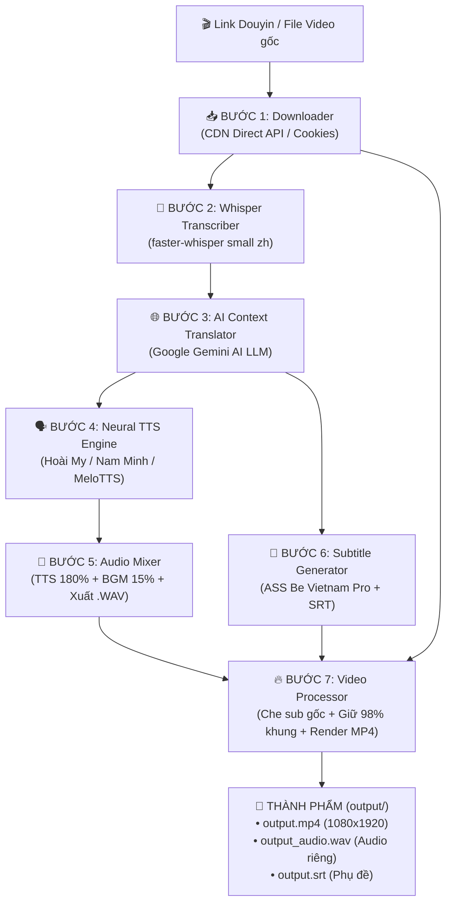

# 🎬 Douyin2TikTok — Hệ Thống Chuyển Đổi Video Douyin Sang TikTok Việt Nam

**Douyin2TikTok** là hệ thống tự động hóa toàn diện từ A-Z, giúp tải video từ **Douyin (TikTok Trung Quốc)**, nhận diện giọng nói, dịch thuật ngữ cảnh bằng **Google Gemini AI**, lồng tiếng chuẩn TikTok (**Hoài My / Nam Minh / MeloTTS**) và xuất video Full HD 1080×1920 sẵn sàng đăng tải.

---

## 🚀 Tính năng nổi bật

- 📥 **Tải video trực tiếp 1080p không logo/watermark:** Tự động bắt link CDN Douyin bằng cookie tài khoản hoặc guest session.
- 🎤 **Nhận diện giọng nói chuẩn xác:** Sử dụng mô hình **Whisper AI (`faster-whisper`)** bóc tách lời thoại tiếng Trung theo mili-giây.
- 🌐 **Dịch thuật ngữ cảnh thông minh (Google Gemini AI):** Dịch toàn bộ kịch bản cùng lúc, hiểu sâu văn phong ẩm thực/vlog, chuẩn đại từ xưng hô (*chị - em gái, anh họ, cả nhà, mình...*).
- 🗣️ **Lồng tiếng Neural AI đa dạng:**
  - **Hoài My (Nữ):** Giọng đọc TikTok "quốc dân", ngọt ngào, truyền cảm.
  - **Nam Minh (Nam):** Giọng nam trầm ấm, chuẩn phong cách review/vlog nam.
  - **MeloTTS Vietnamese:** Mô hình AI tiếng Việt chạy offline nội bộ trên máy.
- 🎵 **Mix âm thanh chuyên nghiệp:** Tự động giảm nhẹ nhạc nền gốc còn 15%, khuếch đại giọng lồng tiếng 180% to rõ, xuất kèm **file Audio riêng biệt (`.wav`)**.
- 📝 **Phụ đề nét căng bên trong video:** Sử dụng font chữ **Be Vietnam Pro Bold**, tự canh chỉnh nằm ngay bên trong khung video (không bị che bởi các nút giao diện TikTok), hỗ trợ xuất file `.srt`.
- 📐 **Tối ưu khung hình TikTok:** Tự động che mờ phụ đề tiếng Trung gốc, giữ lại **98% khung cảnh toàn diện**, xuất video MP4 tỉ lệ **1080 × 1920**.

---

## 🗺️ Sơ đồ luồng xử lý (7-Step Pipeline)



---

## 📂 Cấu trúc thư mục dự án

```text
D:\Antigravity\TIKTOK\
├── 📄 main.py                  # Điểm kích hoạt CLI chính điều phối toàn bộ quy trình
├── 📄 config.py                # File cấu hình trung tâm (AI, TTS, âm lượng, khung hình)
├── 📄 cookies.txt              # Lưu trữ Cookie tài khoản Douyin người dùng
├── 📄 gemini_key.txt           # Khóa Google Gemini AI API
├── 📄 requirements.txt         # Danh sách các thư viện Python
├── 📄 setup_check.py           # Công cụ kiểm tra môi trường và dependencies
├── 📄 set_ai_key.py            # Công cụ cập nhật nhanh khóa Gemini API
├── 📄 set_cookie.py            # Công cụ cập nhật nhanh Cookie Douyin
├── 📁 pipeline/                # 7 module cốt lõi của pipeline
│   ├── downloader.py          # Tải video trực tiếp từ CDN Douyin
│   ├── transcriber.py         # Nhận diện giọng nói tiếng Trung (Whisper)
│   ├── translator.py          # Dịch thuật thông minh với Google Gemini AI
│   ├── tts_engine.py          # Lồng tiếng (Hoài My, Nam Minh, MeloTTS)
│   ├── audio_mixer.py         # Mix âm thanh BGM + TTS + Timeline
│   ├── subtitle_gen.py        # Tạo phụ đề ASS & SRT
│   └── video_processor.py     # Xử lý video, crop 98%, burn sub, render MP4
├── 📁 melo_vietnamese/         # Mã nguồn & trọng số mô hình AI MeloTTS tiếng Việt
├── 📁 assets/fonts/            # Font chữ phụ đề (BeVietnamPro-Bold.ttf)
├── 📁 utils/                   # Tiện ích bổ trợ (ffmpeg, timing, cache, cookie_helper)
├── 📁 output/                  # Thư mục xuất video & audio thành phẩm
├── 📁 temp/                    # Thư mục chứa file tạm trong lúc render
└── 📁 cache/                   # Thư mục lưu trữ video Douyin gốc
```

---

## 🛠️ Hướng dẫn cài đặt

### 1. Yêu cầu hệ thống
* **Hệ điều hành:** Windows 10 / 11
* **Python:** 3.10 trở lên
* **FFmpeg:** 6.0 trở lên (đã thêm vào biến môi trường PATH)

### 2. Cài đặt thư viện
Mở Command Prompt / PowerShell tại thư mục dự án:
```cmd
cd D:\Antigravity\TIKTOK
pip install -r requirements.txt
```

### 3. Cài đặt khóa Gemini AI (Miễn phí)
1. Lấy API key miễn phí tại: [Google AI Studio](https://aistudio.google.com/app/apikey)
2. Lưu key vào file `gemini_key.txt` hoặc chạy:
```cmd
python set_ai_key.py
```

---

## 📖 Hướng dẫn sử dụng

### 1. Video nhân vật NỮ (Mặc định — Giọng Hoài My):
```cmd
python main.py "https://www.douyin.com/video/xxx"
```

### 2. Video nhân vật NAM (Giọng Nam Minh):
```cmd
python main.py "https://www.douyin.com/video/xxx" --voice nam
```

### 3. Chạy với file video có sẵn trên máy:
```cmd
python main.py "D:\video_goc.mp4"
```

### 4. Xuất thêm file phụ đề `.srt` để chỉnh sửa CapCut / Premiere:
```cmd
python main.py "https://www.douyin.com/video/xxx" --export-srt
```

### 5. Sử dụng mô hình AI offline MeloTTS Vietnamese:
```cmd
python main.py "https://www.douyin.com/video/xxx" --tts-engine melo
```

---

## ⚙️ Bảng tham số tùy chỉnh CLI

| Tùy chọn CLI | Viết tắt | Mặc định | Mô tả |
| :--- | :--- | :--- | :--- |
| `--voice` | `-v` | `female` | `female` / `nu` (Hoài My) hoặc `male` / `nam` (Nam Minh) |
| `--tts-engine` | `-te` | `edge` | `edge` (chuẩn Hoài My/Nam Minh) hoặc `melo` (MeloTTS Offline) |
| `--mode` | `-m` | `tts_with_bgm` | `tts_with_bgm` (lồng tiếng + BGM gốc) hoặc `subtitle_only` (chỉ sub) |
| `--export-srt` | | `False` | Xuất thêm file phụ đề `.srt` vào thư mục `output/` |
| `--export-audio`| | `True` | Tự động xuất file audio lồng tiếng riêng biệt (`.wav`) |
| `--cover-position`| `-cp` | `bottom` | Vị trí che phụ đề gốc: `bottom`, `top`, `both` |
| `--cover-percent` | `-c` | `20` | Phần trăm chiều cao khung hình bị che (10-40%) |
| `--whisper-model` | `-w` | `small` | Kích thước model Whisper: `tiny`, `base`, `small`, `medium` |
| `--output` | `-o` | `output/output.mp4` | Đường dẫn file video xuất ra |

---

## 📦 Định dạng file xuất ra (`output/`)

Sau khi hoàn tất, trong thư mục `D:\Antigravity\TIKTOK\output\` sẽ có:
1. `output.mp4`: Video Full HD 1080×1920 hoàn chỉnh có lồng tiếng và phụ đề.
2. `output_audio.wav`: File âm thanh lồng tiếng riêng biệt (WAV 44.1kHz).
3. `output.srt`: File phụ đề tiếng Việt chuẩn thời gian (nếu dùng cờ `--export-srt`).

---

## ⚠️ Lưu ý pháp lý & Bản quyền
* Công cụ này được phát triển phục vụ mục đích học tập, nghiên cứu và sáng tạo nội dung cá nhân.
* Vui lòng tôn trọng quyền tác giả của video gốc, ghi nguồn (credit) tác giả khi đăng tải lại.
